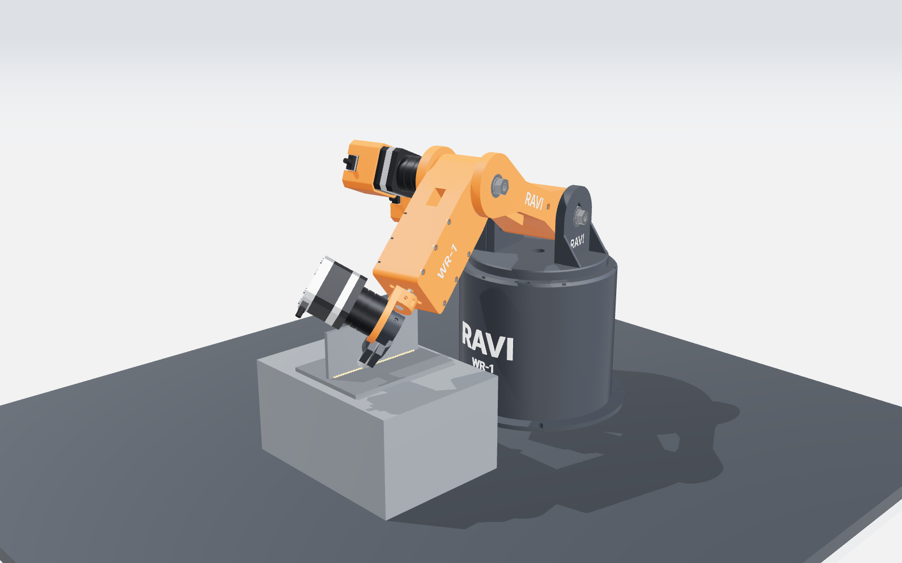
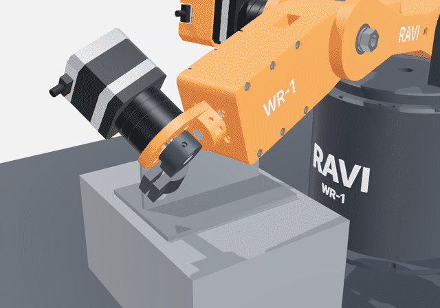
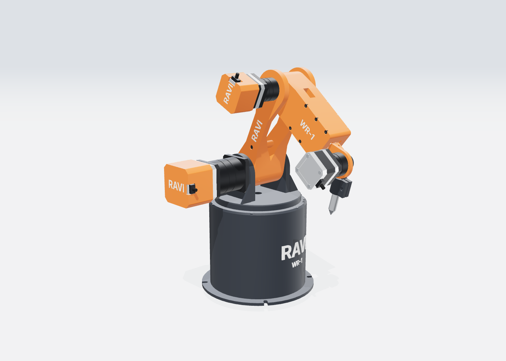
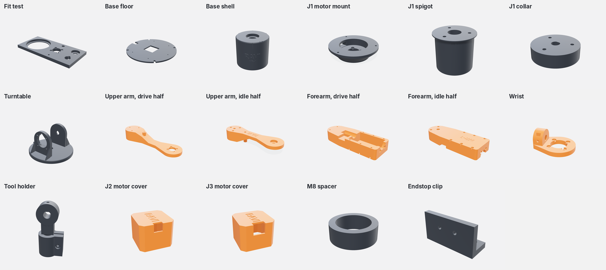

# RAVI WR-1: a 3D-printable 5-axis welding robot



**RAVI WR-1** is an open, step-by-step project to build a welding robot. It starts as a **3D-printed desktop prototype** that you can print, assemble and program for about $500. It then grows into a robot that lays real MIG welds.

The repository has:

- the build plan
- printable parts (parametric OpenSCAD + ready STLs)
- a per-part catalog and bill of materials
- wiring and firmware setup
- an interactive 3D viewer
- the motion software, `Ravi.py`: kinematics, weld path planning with weave, collision checks, G-code and robot control.

| | |
|---|---|
| Arm | 5 axes: base, shoulder, elbow, forearm roll, wrist pitch. A round torch needs no 6th axis. |
| Reach | 410 mm from the shoulder (Phase 1) |
| Drives | Planetary gearmotors: 2 × NEMA17 27:1, 2 × NEMA17 5:1, 1 × NEMA23 10:1 |
| Controller | Arduino Mega 2560 + RAMPS 1.4 running grbl-Mega-5X |
| Software | Python 3 `Ravi.py`. Closed-form inverse kinematics, constant travel speed (G93), weave, keep-out collision check, arc on/off |
| Printed parts | 17 STLs (22 pieces), ≈1.5 kg PETG, fits a 220 × 220 mm bed |

| Weld simulation | Drive side |
|---|---|
|  |  |

*Renders and animation come from the 3D viewer in [`docs/viewer`](docs/viewer). The weld bead and arc glow show what the robot is for. The Phase 1 arm itself holds a pointer or pen, not a torch (see [Safety](docs/SAFETY.md)).*

## Start here

1. Read the **[Build Plan](docs/BUILD_PLAN.md)**: phases, milestones, schedule, risks and the path to real welding.
2. See every part in the **[Parts Catalog](docs/PARTS.md)**: images, print settings, filament and the hardware each part needs.
3. Order from the **[Bill of Materials](docs/BOM.md)**.
4. Print `stl/fit_test.stl`, tune `cad/config.scad`, then print everything: **[Printing Guide](docs/PRINTING.md)**.
5. Build it: **[Assembly Guide](docs/ASSEMBLY.md)**.
6. Wire, flash, home and calibrate: **[Electronics, Firmware and Calibration](docs/ELECTRONICS.md)**.
7. Program welds: **[Software Guide](docs/SOFTWARE.md)**.
8. Before anything moves, and before any arc: **[Safety](docs/SAFETY.md)**.



## Quick start (software only, no robot needed)

```bash
pip install -r requirements.txt
python Ravi.py info
python Ravi.py torque
python Ravi.py plan jobs/fillet_straight.json --png    # writes out/fillet_straight.gcode + preview
python -m pytest
```

To explore the robot in 3D, serve the repository and open the viewer:

```bash
python -m http.server 8000      # then open http://localhost:8000/docs/viewer/
```

The viewer has joint sliders and plays the example weld jobs. On GitHub, you can turn on **Settings → Pages** for this branch (root folder) to host it at `https://<user>.github.io/welding-robot/docs/viewer/`.

## Repository layout

```
Ravi.py              main program (plan, reach, torque, pose/fk, home, jog, run, grbl settings)
config/robot.json    geometry, joint limits, motors, masses: the software's single source of truth
robot/               kinematics, weld planner, collision check, G-code, statics, simulator, serial sender
jobs/                example weld jobs with keep-out zones (pen square, fillet, butt weave, tube fillet)
cad/                 OpenSCAD: config.scad (all dimensions), parts.scad, vitamins.scad (motors, bearings,
                     bolts), assembly.scad, build.sh, fonts/, render/ (viewer mesh export, image renders)
stl/                 ready-to-print parts (generated by cad/build.sh)
docs/                plan, parts catalog, BOM, printing, assembly, electronics, software, safety, viewer/
firmware/            grbl-Mega-5X settings generated from robot.json
tests/               pytest suite
```

## Status

| Part | State |
|---|---|
| Software (kinematics, planner, collision check, G-code, preview, torque/reach tools) | Working, 20 tests passing |
| CAD Rev B (17 printable parts with RAVI branding and motor covers) | Generated, watertight, bed-fit checked. **Not yet test-printed:** print `fit_test.stl` first and expect small fixes. |
| Firmware | grbl-Mega-5X with generated settings |
| Phase 2 (real welding) | Planned in [docs/BUILD_PLAN.md](docs/BUILD_PLAN.md) |

> **The Phase 1 arm is not built to hold a live welding torch.** It holds a pen or pointer, and its arc output drives an LED. Real welding needs the Phase 2 upgrades and the welding cell described in the plan.

Designed by **Ravi**.
