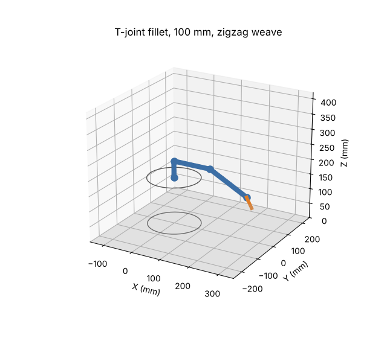

# Ravi WR-1: a 3D-printable 5-axis welding robot


WR-1 is an open, step-by-step project to build a welding robot. It starts as a **3D-printed desktop prototype** that you can print, assemble and program for about $500. It then grows into a robot that lays real MIG welds.

The repository has:

- the **build plan**
- **printable parts** (parametric OpenSCAD + ready STLs)
- a **bill of materials**
- **wiring and firmware** setup
- the **motion software** (`Ravi.py`): kinematics, weld path planning with weave, G-code, preview and robot control.

| | |
|---|---|
| Arm | 5 axes: base, shoulder, elbow, forearm roll, wrist pitch. A round torch needs no 6th axis. |
| Reach | 410 mm from the shoulder (Phase 1) |
| Drives | NEMA17/NEMA23 planetary gearmotors |
| Controller | Arduino Mega 2560 + RAMPS 1.4 running grbl-Mega-5X |
| Software | Python 3, `Ravi.py`. Closed-form inverse kinematics, constant travel speed (G93), weave, arc on/off |
| Printed parts | 15 STLs, ~1.3 kg PETG, fits a 220 × 220 mm bed |



## Start here

1. Read the **[Build Plan](docs/BUILD_PLAN.md)**: phases, milestones, schedule, risks and the path to real welding.
2. Order parts from the **[Bill of Materials](docs/BOM.md)**.
3. Print `stl/fit_test.stl`, tune `cad/config.scad`, then print everything: **[Printing Guide](docs/PRINTING.md)**.
4. Build it: **[Assembly Guide](docs/ASSEMBLY.md)**.
5. Wire it, flash it, home it, calibrate it: **[Electronics, Firmware and Calibration](docs/ELECTRONICS.md)**.
6. Program welds: **[Software Guide](docs/SOFTWARE.md)**.
7. Before anything moves, and before any arc: **[Safety](docs/SAFETY.md)**.

## Quick start (software only, no robot needed)

```bash
pip install -r requirements.txt
python Ravi.py info
python Ravi.py torque
python Ravi.py plan jobs/fillet_straight.json --png --gif    # writes out/fillet_straight.{gcode,png,gif}
python -m pytest
```

## Repository layout

```
Ravi.py              main program (plan, simulate, home, jog, run, settings, torque, reach)
config/robot.json    robot geometry, joint limits, motors, masses: the software's single source of truth
robot/               kinematics, weld planner, G-code, statics, simulator, serial sender
jobs/                example weld jobs (pen square, fillet with weave, butt with weave, tube fillet)
cad/                 OpenSCAD sources: config.scad (all dimensions), parts.scad, assembly.scad, build.sh
stl/                 ready-to-print parts (generated by cad/build.sh)
firmware/            grbl-Mega-5X settings generated from robot.json
docs/                plan, BOM, printing, assembly, electronics, software, safety
tests/               pytest suite
```

## Status

| Part | State |
|---|---|
| Software (kinematics, planner, G-code, preview, torque/reach tools) | Working, 18 tests passing |
| CAD Rev A (15 printable parts) | Generated, watertight, bed-fit checked. **Not yet test-printed:** print `fit_test.stl` first and expect small fixes. |
| Firmware | grbl-Mega-5X with generated settings |
| Phase 2 (real welding) | Planned in [docs/BUILD_PLAN.md](docs/BUILD_PLAN.md) |

> **The Phase 1 arm is not built to hold a live welding torch.** It holds a pen or pointer, and its arc output drives an LED. Real welding needs the Phase 2 upgrades and the welding cell described in the plan.

Author: Ravi
