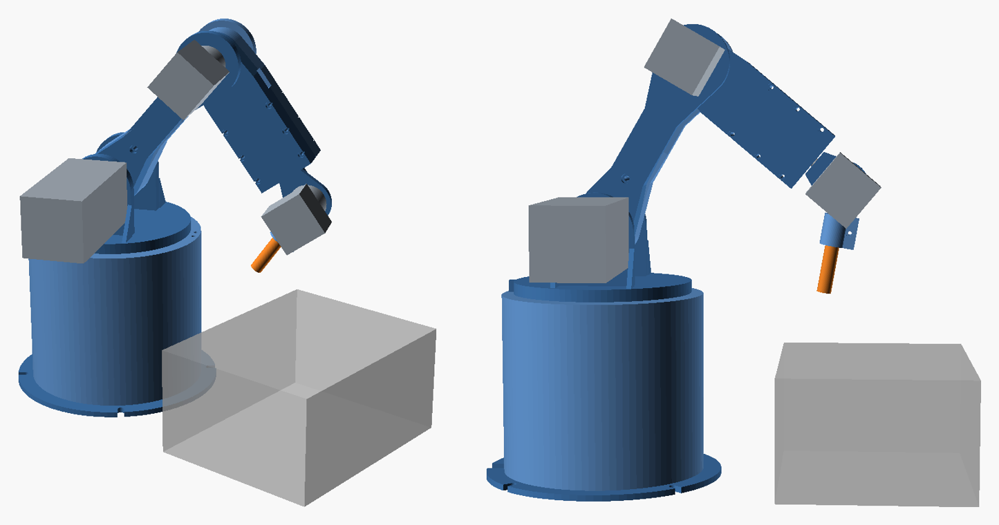

# Assembly Guide

Joint naming and zero positions are the same everywhere (software, CAD and firmware):

| Joint | Axis letter | Zero position | + direction |
|---|---|---|---|
| J1 base yaw | X | arm points along +X (front of the base, opposite the cable hole) | counter-clockwise seen from above |
| J2 shoulder | Y | upper arm vertical | leans forward |
| J3 elbow | Z | forearm at 90° to the upper arm | forearm bends down |
| J4 forearm roll | A | wrist motor on the left (−Y side) | right-hand rule about the forearm axis |
| J5 wrist pitch | B | tool at 90° to the forearm | tool tips back towards the forearm |

"Drive side" is −Y, where the J2 and J3 motors sit. "Idle side" is +Y, with the 608 bearings.

## 1. Base and J1

1. Screw `base_floor` to `base_shell` with 6 × M3 × 10 countersunk screws. The cable notch lines up with the cable hole at the back.
2. Press one **6008** into the top of the bearing tower (from the deck side). Press the second one into the bottom (from inside the shell). Both outer races must sit hard against the printed ring between them.
3. Drop `j1_spigot` into the bearings from the top. Its lip rests on the upper inner race.
4. Put `turntable` on top. Line up the 3 holes with the spigot holes.
5. From below, put `j1_collar` against the lower inner race (flat side down, the D-bore toward the motor). Drive 3 × **M3 × 50** up through the collar and spigot into the turntable inserts.
6. Tighten the three screws evenly, a quarter turn at a time, until the turntable turns smoothly with **no axial play** and no notchiness. This preloads the bearing pair. Too tight feels gritty: back off.
7. Bolt the J1 gearmotor face to `j1_motor_mount` with 4 × M3 × 10 button heads (screws from the inside).
8. Turn the collar so its set screw faces a window. Lift the mount into place: the shaft goes into the collar and the flat faces the set screw. Fix the mount to the tower inserts with 3 × M3 × 10.
9. Insert an M3 nut into the collar's nut slot and tighten the M3 set screw on the shaft flat. Add a drop of medium threadlocker.

## 2. Shoulder (J2) and upper arm

1. Press a **608** into the idle (+Y) cheek of the turntable from the outside.
2. Bolt the J2 gearbox to the outside of the drive (−Y) cheek with 4 × M5 × 14 button heads from the inside.
3. Upper arm, idle half: drop an **M8 × 50** bolt into the hex pocket on the flat (split) face so the thread points out through the half.
4. Upper arm, drive half: fit the key in the J2 shaft keyway and check that the keyed bore slides over it.
5. Hold the two halves together between the cheeks:
   - drive half onto the J2 shaft (key in the keyway)
   - M8 bolt through a `spacer_m8`, then through the 608, then a washer and an M8 nylock.
6. Bolt the halves with 4 × **M4 × 65** (heads on the drive side, nuts in the idle-side pockets). Tighten the M8 nylock until the 608 inner race is clamped and the arm still turns freely.
7. Tighten the J2 set screw onto the key (nut in its slot first).

## 3. Elbow (J3) and forearm

1. Press a **608** into the idle cheek at the elbow end of the upper arm, from the outside.
2. Bolt the J3 gearbox into the recess on the drive cheek with 4 × M3 × 8 button heads from the inside.
3. Forearm: put the J4 gearmotor into the pocket of one half, with its gearbox face against the front plate.
4. Close the second half over it. Push the M8 × 45 pivot bolt (head in the hex pocket of the idle half) through.
5. Fit the forearm root between the elbow cheeks:
   - D-bore onto the J3 shaft
   - M8 through `spacer_m8`, then the 608, then washer and nylock.
6. Fit 8 × **M3 × 45** with nuts through the forearm halves.
7. Screw the J4 gearbox to the front plate: 4 × M3 × 8 from the front.
8. Tighten the J3 set screw on the flat.
9. Route the J4 motor cable back through the channel and out of the slot on top of the forearm.

## 4. Wrist (J4/J5) and tool

1. Bolt the J5 gearmotor to `wrist` (face against the round plate, screws from the tool side).
2. Push `wrist` onto the J4 shaft and tighten its set screw on the flat. At J4 = 0, the J5 motor should stick out to the −Y side.
3. Push `tool_holder` onto the J5 shaft and tighten its set screw.
4. Clamp the pointer or pen in the tool holder with the M3 × 16 pinch screw. Push it up to the stop.
5. Measure the distance from the J5 shaft centre line to the tip. Enter it as `"tool"` in `config/robot.json` (default 90 mm). That's 66 mm of tool showing below the stop.

## 5. Homing switches

Screw an `endstop_clip` with a microswitch at each joint. The lever must be hit by a moving part at the end of the joint's range:

| Joint | Switch on | Hit by | Trips at (robot.json `home`) |
|---|---|---|---|
| J1 | deck inserts at 30°, outside the turntable | the dog on the turntable rim | −150° |
| J2 | drive cheek of the turntable, at the back | the upper arm root leaning back | −45° |
| J3 | upper arm, near the elbow | the forearm folding down | +75° |
| J4 | forearm front plate | a screw head on the wrist hub | −170° |
| J5 | wrist plate | the tool holder arm | −115° |

The `home` angles in `robot.json` are where each joint ends up **after** homing, including grbl's 2° pull-off. You measure the real values during calibration ([ELECTRONICS.md](ELECTRONICS.md#calibration)), so exact switch placement doesn't matter. Repeatability does.

## 6. Mount and cable management

- **Clamp or bolt the base to the bench** through the four slots. At full reach the arm puts about 8 N·m of tipping moment on the base.
- Give the cables loose service loops at J1 (±150°) and J4 (±170°). Use spiral wrap, and tie down at the turntable, the upper arm and the forearm cable exit.
- Place the 100 mm work block in front of the robot, 150–300 mm from the base centre.
