# Parts Catalog: what each part is, how to print it, what it needs

The robot has 17 printed STL files (19 printed pieces) and 5 gearmotors, plus bearings and hardware. Each part below lists its print settings, how much filament it takes, and the hardware that goes with it. The full shopping list is in [BOM.md](BOM.md).

**Colours used in the renders:** arm parts in orange PETG, base parts in graphite or black PETG. The RAVI and WR-1 lettering is raised (base) or recessed (arm, turntable, covers). Go over it with a white paint pen for contrast.

Filament and time are estimates for PETG at 0.2 mm layers with a 0.4 mm nozzle, using the settings given.

## Summary

| # | Part (STL) | Qty | Colour | Settings | Filament | Print time |
|---|---|---|---|---|---|---|
| 1 | `fit_test` | 1 | any | 4 walls, 40 % | 55 g | 4.5 h |
| 2 | `base_floor` | 1 | graphite | 4 walls, 40 % | 115 g | 9 h |
| 3 | `base_shell` | 1 | graphite | 4 walls, 40 %, upside down | 375 g | 29 h |
| 4 | `j1_motor_mount` | 1 | graphite | 4 walls, 40 % | 47 g | 4 h |
| 5 | `j1_spigot` | 1 | graphite | 100 % | 53 g | 4.5 h |
| 6 | `j1_collar` | 1 | graphite | 100 % | 22 g | 2 h |
| 7 | `turntable` | 1 | graphite | 5 walls, 50 % | 230 g | 18 h |
| 8 | `upper_arm_drive` | 1 | orange | 5 walls, 50 % | 150 g | 12 h |
| 9 | `upper_arm_idle` | 1 | orange | 5 walls, 50 % | 160 g | 12.5 h |
| 10 | `forearm_drive` | 1 | orange | 4 walls, 40 % | 92 g | 7.5 h |
| 11 | `forearm_idle` | 1 | orange | 4 walls, 40 % | 92 g | 7.5 h |
| 12 | `wrist` | 1 | orange | 6 walls, 60 % | 13 g | 1.5 h |
| 13 | `tool_holder` | 1 | graphite | 6 walls, 60 % | 17 g | 1.5 h |
| 14 | `j2_cover` | 1 | orange | 3 walls, 20 % | 24 g | 2 h |
| 15 | `j3_cover` | 1 | orange | 3 walls, 20 % | 13 g | 1.5 h |
| 16 | `spacer_m8` | 2 | graphite | 100 % | 1 g | 0.5 h |
| 17 | `endstop_clip` | 5 | graphite | 4 walls, 40 % | 8 g | 2 h |
| | **Total** | **22 pieces** | | | **≈ 1.5 kg** | **≈ 110–140 h** |

---

## Base and J1 (base yaw)

### 1. `fit_test`
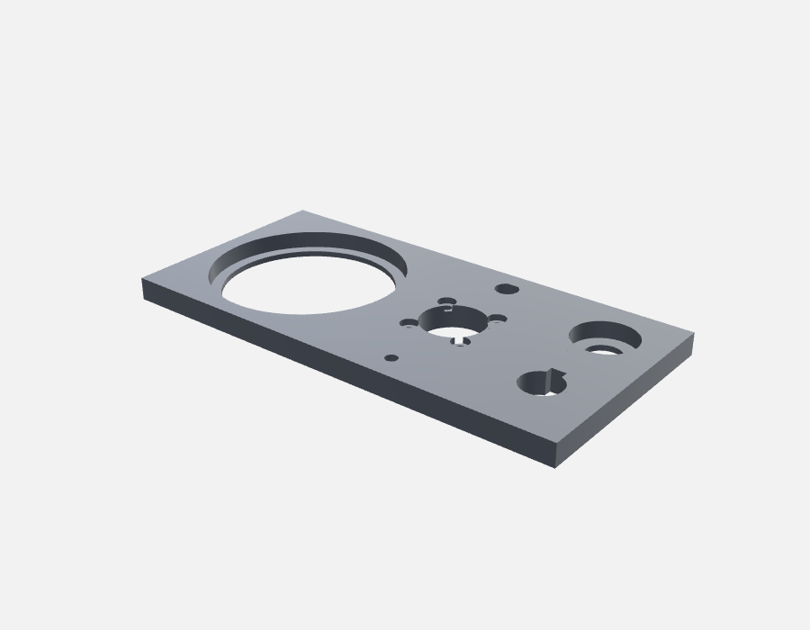

Print this first. It tests every critical fit with the real hardware:
- 6008 and 608 bearing seats
- J1/J3 gearbox face (pilot and 4 screw holes)
- 8 mm D-shaft and 14 mm keyed-shaft bores
- one heat-set insert hole.

Adjust `cad/config.scad` until everything fits ([PRINTING.md](PRINTING.md)).

**Hardware:** none (test with a 6008, a 608, the J1 gearmotor, the J2 shaft and one M3 insert).
 

### 2. `base_floor`
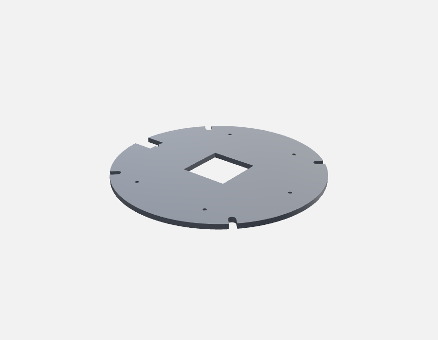

Ø200 mm floor plate. Four open slots clamp or bolt the robot to the bench (needed at full reach). The square opening gives clearance for the J1 gearmotor.

**Hardware:**
- 6 × M3 × 10 countersunk (into the shell)
- 4 × M6 bolts or bench clamps.
 

### 3. `base_shell`
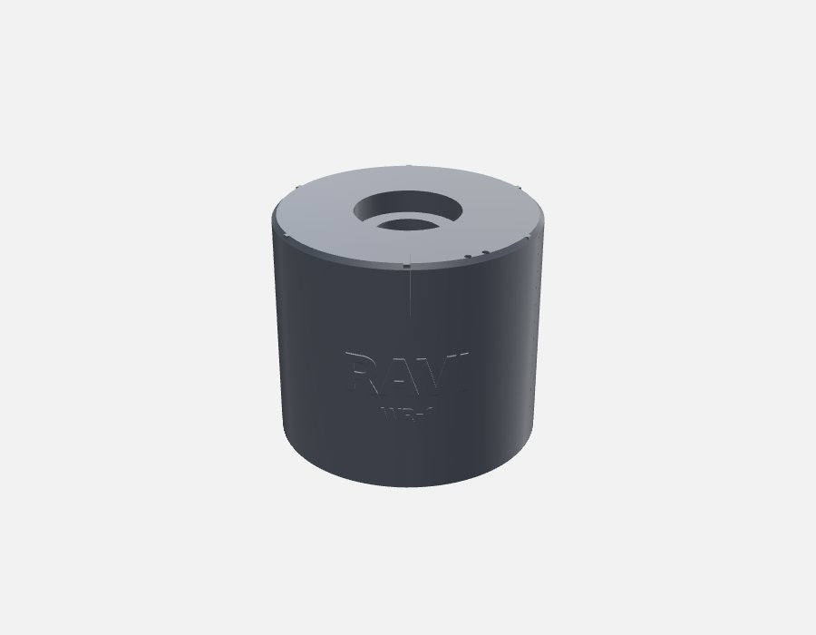

Main body of the base, printed upside down with the deck on the bed. It has:
- raised **RAVI / WR-1** lettering on the front
- the bearing tower for the two 6008 bearings, with a spacer ring between them
- a cable exit at the back.

**Hardware:**
- 11 × M3 heat-set inserts: 6 floor bosses, 3 under the tower, 2 for the J1 switch
- 2 × 6008-2RS bearings
- 1 endstop clip + microswitch.
 

### 4. `j1_motor_mount`
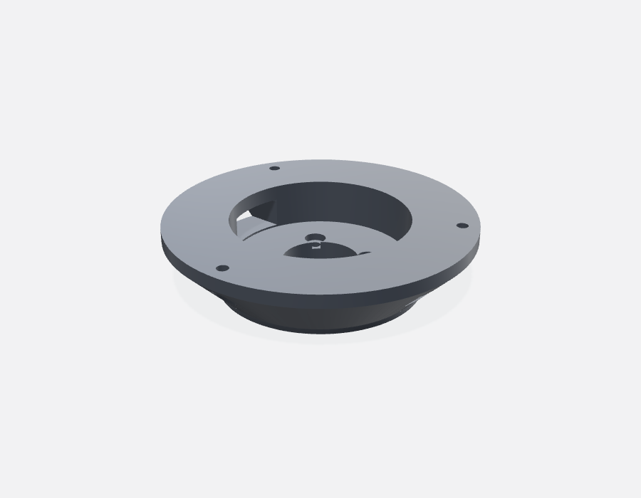

A cup that holds the J1 gearmotor under the bearing tower. Two side windows let you reach the collar set screw.

**Hardware:**
- J1 gearmotor
- 4 × M3 × 10 button head (into the gearbox face)
- 3 × M3 × 10 button head (into the tower inserts).
 

### 5. `j1_spigot`
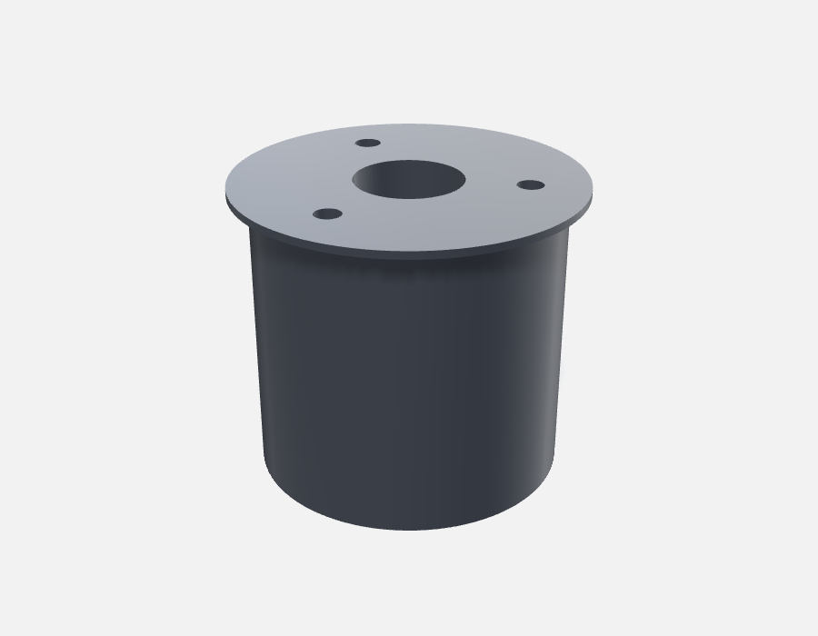

Ø40 mm tube through both 6008 bearings. Its top lip presses the upper inner race. It is 0.5 mm shorter than the bearing stack, so tightening the collar preloads the pair. Print it at 100 % infill.

**Hardware:** clamped by the 3 × M3 × 50 collar screws.
 

### 6. `j1_collar`
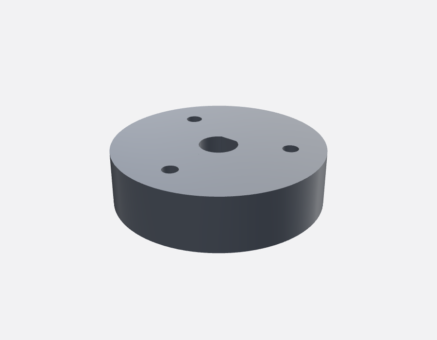

Couples the J1 shaft (D-bore) to the spigot, and presses the lower inner race up to preload the bearings.

**Hardware:**
- 3 × M3 × 50 socket head (into the turntable inserts)
- 1 × M3 × 8 set screw + M3 nut (on the shaft flat).
 

### 7. `turntable`
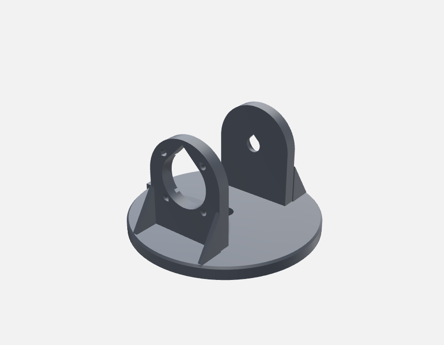

Rotating top of the base, with the shoulder yoke:
- drive cheek (−Y) with the J2 gearbox mount
- idle cheek (+Y) with a 608 seat and recessed **RAVI** lettering
- side gussets
- the J1 homing dog.

**Hardware:**
- 3 × M3 heat-set inserts
- J2 gearmotor + 4 × M5 × 14 button head
- 1 × 608-2RS
- 1 endstop clip.
 

## Arm

### 8–9. `upper_arm_drive` + `upper_arm_idle`
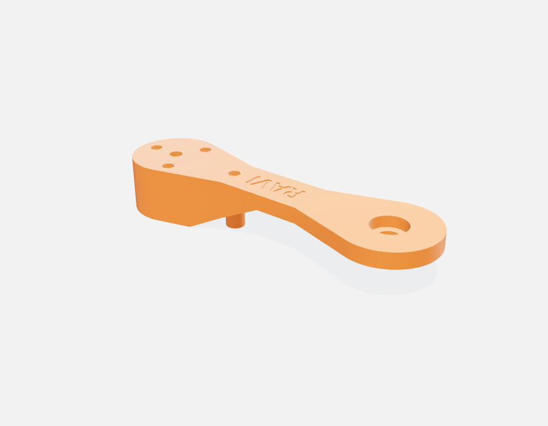

Two halves of the upper arm. Each prints flat on its outer face and carries recessed **RAVI** lettering.
- **Drive half:** keyed bore for the J2 shaft, and the J3 gearbox mount at the elbow.
- **Idle half:** a pocket for the M8 pivot bolt head, and the 608 seat at the elbow.

**Hardware:**
- 4 × M4 × 65 socket head + 4 M4 nuts
- M8 × 50 + washer + nylock + `spacer_m8` (shoulder pivot)
- J3 gearmotor + 4 × M3 × 8 button head
- 1 × 608-2RS (elbow)
- J2 key + M3 set screw + nut.
 

### 10–11. `forearm_drive` + `forearm_idle`
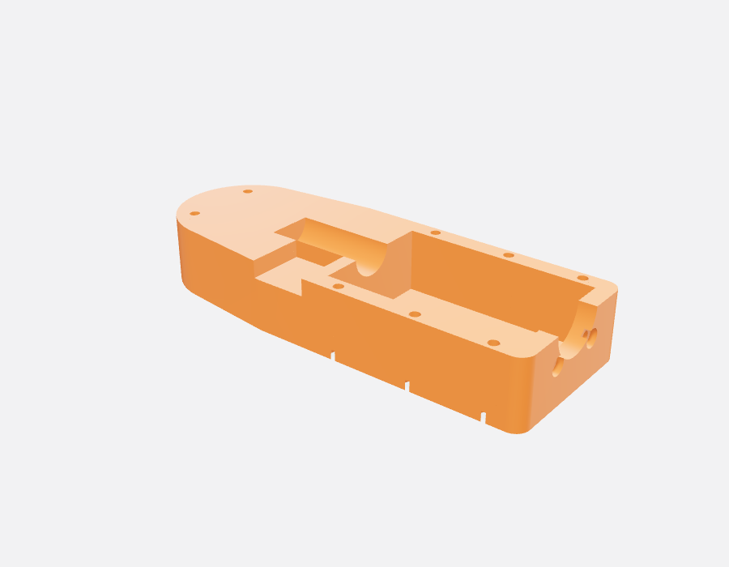

Clamshell forearm.
- The J4 gearmotor sits inside, and its gearbox bolts to the split front plate.
- A cable channel runs back to an exit on top.
- **WR-1** lettering is recessed on both sides.
- The drive half has the J3 D-bore and set screw.

**Hardware:**
- 8 × M3 × 45 socket head + 8 M3 nuts
- M8 × 45 + washer + nylock + `spacer_m8` (elbow pivot)
- J4 gearmotor + 4 × M3 × 8 button head
- M3 set screw + nut.
 

### 12. `wrist`
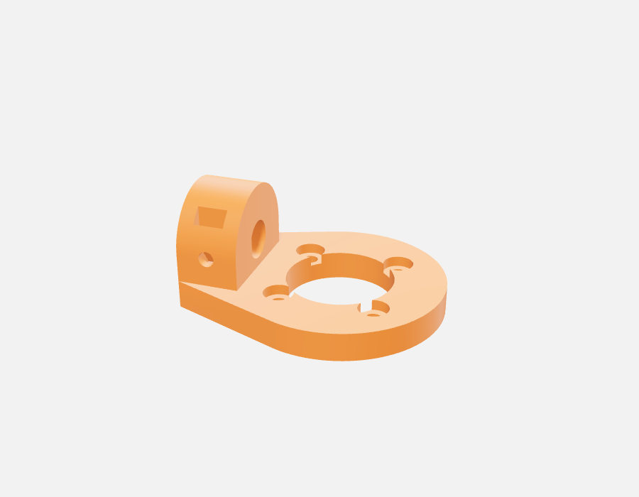

Clamps onto the J4 shaft and carries the J5 gearmotor at 90°, so the J5 axis crosses the forearm axis at the wrist centre. That's what makes the inverse kinematics exact.

**Hardware:**
- J5 gearmotor + 4 × M3 × 8 button head
- M3 set screw + nut.
 

### 13. `tool_holder`
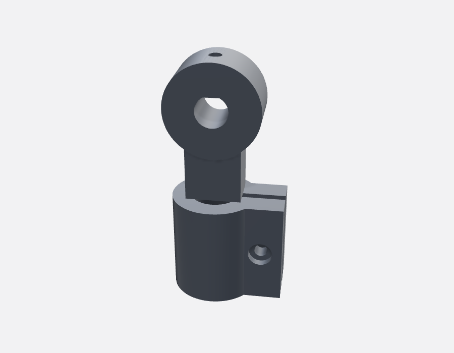

Clamps onto the J5 shaft and holds a Ø12 mm tool (pointer, pen sleeve, laser module). The tool's top end butts against a stop 24 mm below the wrist centre, so the tool length is repeatable.

**Hardware:**
- M3 set screw + nut
- M3 × 16 + nut (pinch clamp)
- Ø12 mm pointer.
 

### 14–15. `j2_cover`, `j3_cover`
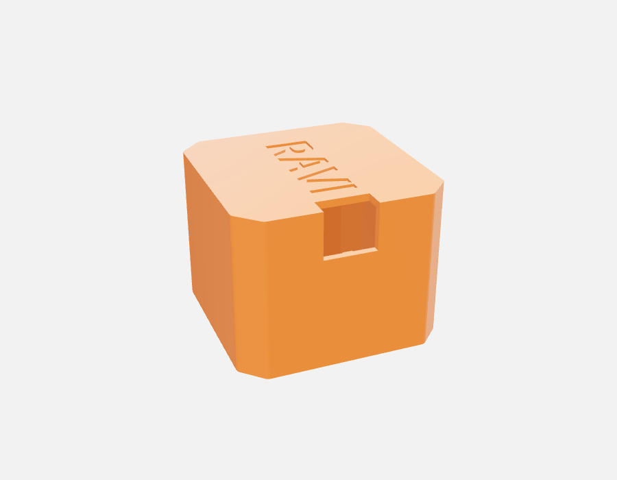

Push-on covers over the back of the J2 (NEMA23) and J3 (NEMA17) motors.
- Four small crush ribs inside grip the motor.
- A slot clears the cable outlet. Turn the cover to match your motor.
- **RAVI** lettering on the end.

They only add 13–24 g.

**Hardware:** none.
 

### 16. `spacer_m8` (×2)
Sits between each arm hub and the inner race of its 608 bearing, so the nylock clamps the inner race and not the cheek.

### 17. `endstop_clip` (×5)
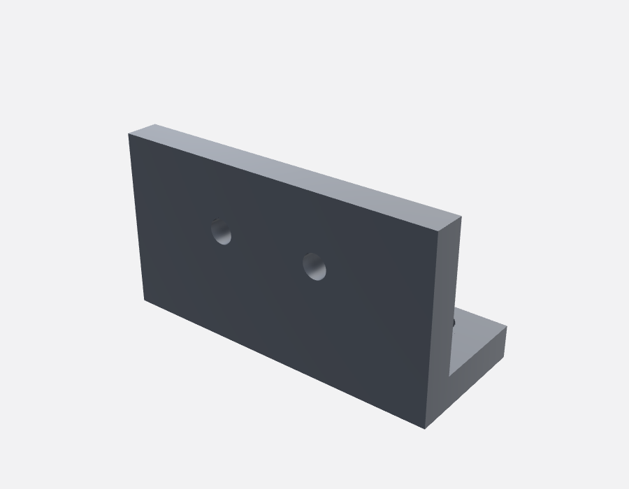

Universal bracket for a KW11 / SS-5GL lever microswitch (M2 holes 9.5 mm apart). Screw it wherever a moving part can press the lever at the end of the joint's range ([ASSEMBLY.md](ASSEMBLY.md#5-homing-switches)).

**Hardware (each):**
- 2 × M2 × 10 + M2 nuts
- 2 × M3 × 8
- 1 microswitch.
 

---

## Motors and bearings

Example part numbers come from sellers' listings. **Check the seller's drawing before printing:** gearbox faces and shafts vary between vendors, so measure yours and set `GM17_48`, `GM17_34` and `GM23_56` in `cad/config.scad`.

| Joint | Gearmotor | Example part | Key data | Mass |
|---|---|---|---|---|
| J1 base, J3 elbow | NEMA17 48 mm, 1.68 A + planetary ≈27:1 (exact 26.85:1), 8 mm D-shaft | StepperOnline **17HS19-1684S-PG27** | max permissible output torque 3 N·m; no-load backlash listed between 1° and 3° depending on the seller | ≈0.55 kg |
| J4 roll, J5 wrist | NEMA17 34 mm + planetary ≈5:1 (exact 5.18:1), 8 mm D-shaft | StepperOnline **17HS13-0404S-PG5** (0.4 A); heavier alternative **17HS19-1684S-PG5** | light loads (<0.3 N·m) | ≈0.35 kg |
| J2 shoulder | NEMA23 56 mm, 2.8 A + 10:1 planetary, 14 mm keyed output | Buy motor and gearbox **as one unit** so the motor shaft matches the gearbox input | gearbox rated ≥10 N·m; driven by a DM542T | ≈1.4 kg |

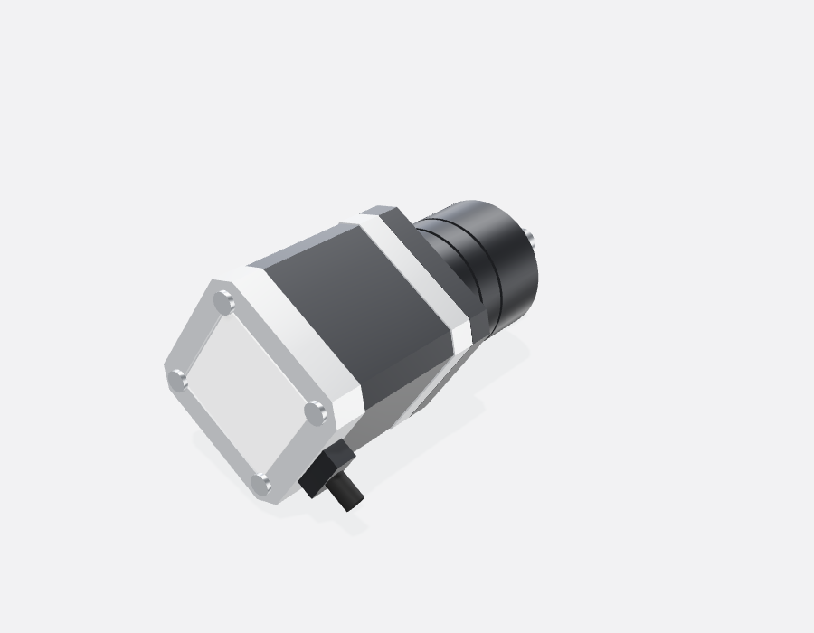
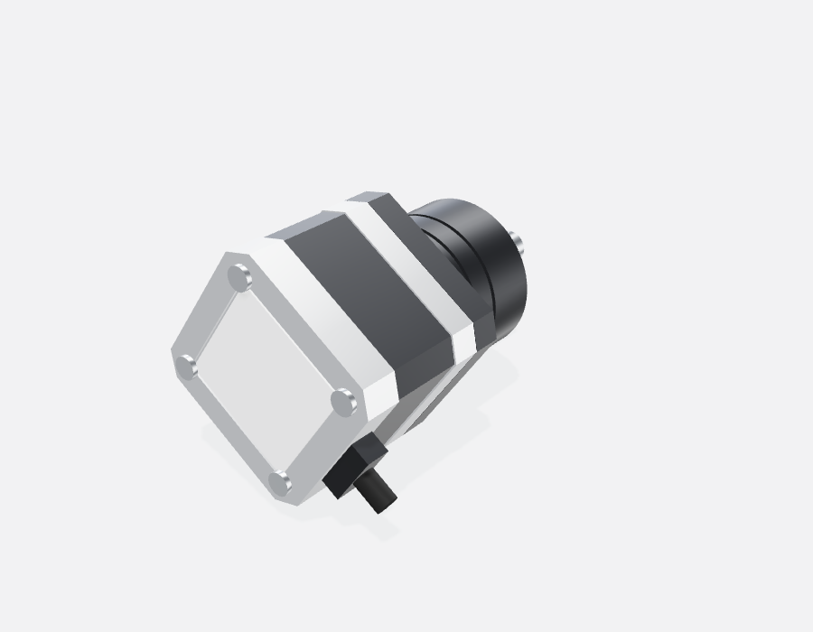
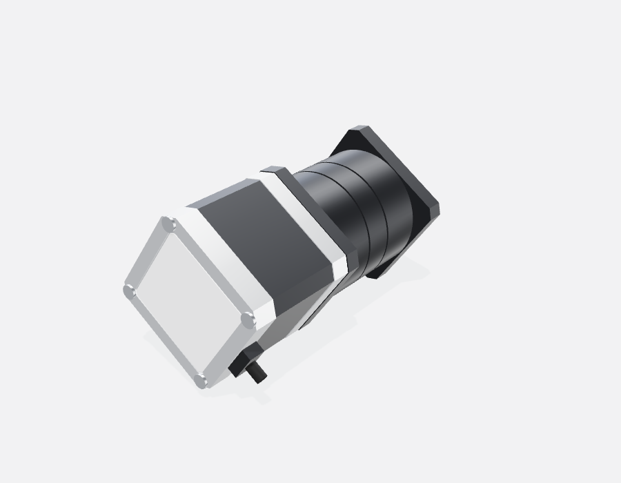

| Bearing | Size | Qty | Where |
|---|---|---|---|
| 6008-2RS | 40 × 68 × 15 | 2 | J1 bearing tower (back-to-back, preloaded) |
| 608-2RS | 8 × 22 × 7 | 2 (+2 spare) | idle side of the shoulder and elbow pivots |

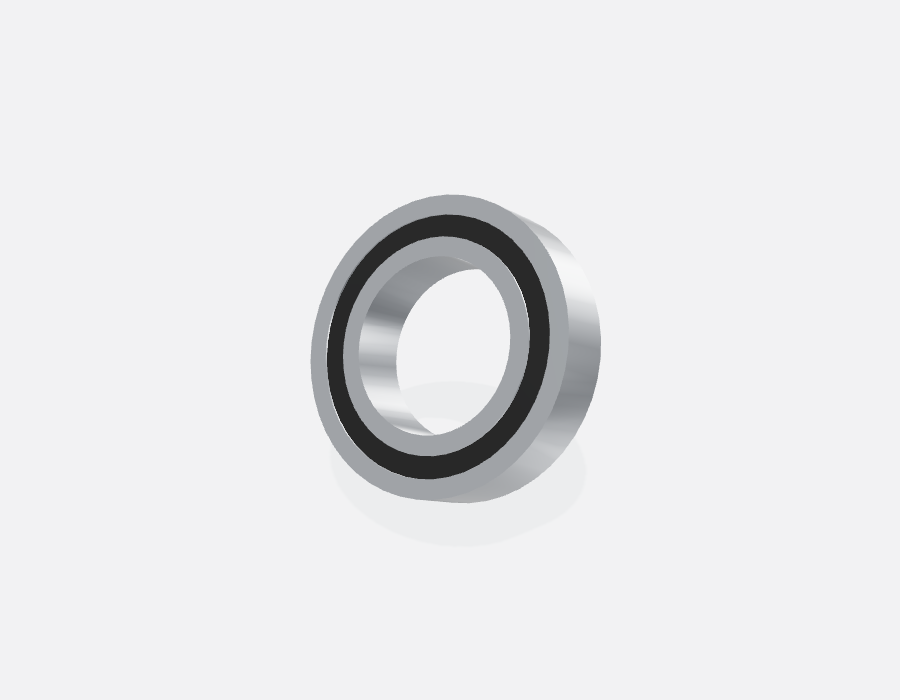
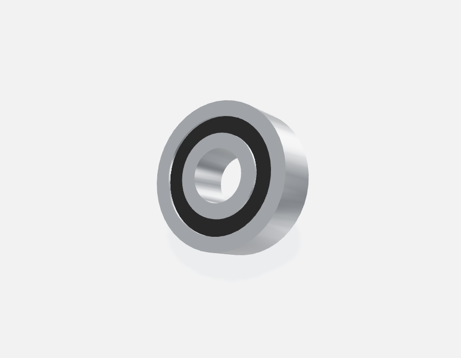

> **Backlash matters.** 1° of backlash at J2 or J3 moves the tool tip by about 4–7 mm (more at full reach). Phase 1 lives with it: gravity preloads J2/J3 and the planner always approaches seams from the same side. For Phase 2 welding, buy precision gearboxes (≤15–20 arcmin).
